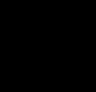

# Witchports



Witchports finds local TCP listeners, labels recognizable web frameworks, and lets you stop the process holding a port. It runs on macOS and Linux with Python 3.10+, `ps`, and `lsof`. On Linux, install `lsof` through your package manager if it is missing.

## Install

### From GitHub

**With pip**

```sh
python3 -m venv ~/.venvs/witchports
source ~/.venvs/witchports/bin/activate
python -m pip install "git+https://github.com/nelsonroque/witchports.git"
witchports
```

**With uv**

```sh
uv tool install "git+https://github.com/nelsonroque/witchports.git"
witchports
```

Use `uvx` to run Witchports on demand.

```sh
uvx --from "git+https://github.com/nelsonroque/witchports.git" witchports
```

### From a local checkout

Run these commands from the project directory.

```sh
python3 -m venv .venv
source .venv/bin/activate
python -m pip install .
witchports
```

## Use

With no arguments, Witchports opens a Textual dashboard. Enter a port or inclusive range such as `3000-9000` and press **Enter** to scan. Search by port, PID, framework, address, or command. Select a row and press **Enter** or click **Stop selected** to review and confirm the stop.

```sh
witchports list                         # All visible TCP listeners
witchports scan 3000-9000               # Only listeners in this range
witchports scan 8000 --web              # Only recognized web apps or servers
witchports stop 8000                    # Confirm and send SIGTERM
witchports stop 8000 --pid 12345        # Select one owner of a shared port
witchports stop 8000 --pid 12345 --yes  # Confirm in advance for scripts
witchports stop 8000 --force            # Confirm and send SIGKILL
```

The scanner reads the local socket table. It reports TCP listeners visible to your account in the current network namespace, including loopback and wildcard bindings. Framework names are inferred from the process and its launcher. For `uvicorn main:app`, Witchports can identify a directly declared FastAPI instance by reading the entry point without importing it. When the entry point is unavailable or uses a factory, the row may show Uvicorn (ASGI).

Stopping a process can release every port it owns. If a supervisor restarts it or another PID shares the port, the port can remain in use. On a shared port, the dashboard targets the selected PID and the command requires `--pid`.
